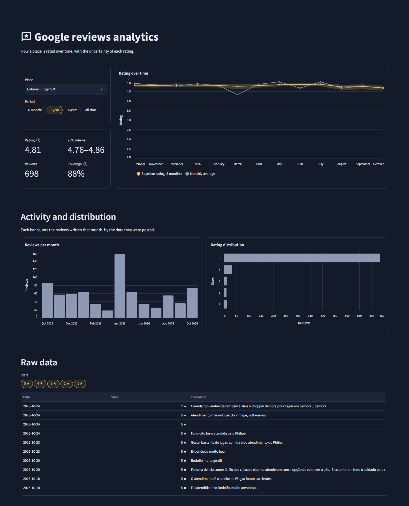

# Google Reviews Analytics

A pipeline that collects the Google Maps reviews of a place, stores them in a local database and shows them in an interactive dashboard. It answers three questions about the place: how well it is rated, how certain that rating is, and how it has changed over time.

The current data covers Cabana Burger, a burger restaurant in São José dos Campos, Brazil.



## How it works

```
places.csv ─▶ Chrome (Selenium, logged-in profile) ─▶ qv9Egd responses ─▶ parser ─▶ DuckDB ─▶ Streamlit
```

### Collecting reviews

For each place in `places.csv`, the scraper opens Google Maps in Chrome, reads the total number of reviews the place lists, sorts the reviews by newest and scrolls the review panel. Each scroll makes Maps fetch the next page of reviews through an internal RPC call (`batchexecute`, method `qv9Egd`), which returns 10 reviews and a token for the next page. The scraper does not make these requests itself: it reads Maps' own responses from Chrome's network log, and keeps only the ones sorted by newest. It stops when a page comes without a next-page token, or when Maps stops answering for 60 seconds.

Two constraints shaped this design:

- **Login.** Without a Google account, Maps shows a limited view with only a handful of reviews, and the RPC call answers with a permission error. The scraper uses a dedicated Chrome profile, logged in once by hand.
- **Bot protection.** Each request carries a BotGuard token (`x-maps-bgkey`) that Maps' own JavaScript generates. Replaying the requests outside the page would mean forging or reusing that token, so the project lets the browser make every request and only reads the responses.

The scraper blocks images to keep the page light, waits a random time between actions, and retries clicks when Maps re-renders an element.

### Storing reviews

Reviews go to a local DuckDB database with three tables: `places` (each place and the total Maps lists), `reviews` and `scrape_runs` (one row per collection: status, pages, new reviews and errors). Each review is stored with its Google ID, star rating, text, creation and last edit dates; the author's name is replaced by a SHA-256 hash. Inserts are upserts on the review ID, so running the scraper again never duplicates a review and picks up edited ratings.

The dashboard reads plain SQL files from `database/queries/`, such as the monthly volume and average rating, with a rolling window of three calendar months weighted by the number of reviews.

### Measuring the rating

A plain average is unreliable for small samples: 5.0 from 3 reviews is not better than 4.8 from 500. The dashboard models the share of each star rating with a Dirichlet-multinomial model. The prior is worth 20 reviews, shaped like all the reviews collected, so a place with few reviews is pulled toward the overall average. The rating shown is the posterior mean of $\sum_k k \cdot p_k$, and its 95% credible interval comes from 4,000 draws of the posterior. The same model, applied to rolling 3-month windows, draws the uncertainty band in the rating chart: the band is wide in months with few reviews and narrow when there are many.

## Repository structure

```
├── main.py                 runs the scraper for every place in places.csv
├── places.csv              places to monitor: id, name, Google Maps link, category
├── scraping/
│   ├── browser.py          Chrome session, clicks, sorting and network capture
│   ├── reviews.py          parser for the qv9Egd responses
│   └── pipeline.py         collects one place and records the run
├── database/
│   ├── schema.sql          tables places, reviews and scrape_runs
│   ├── connection.py       opens the DuckDB file and loads SQL queries
│   ├── repository.py       inserts, upserts and run tracking
│   └── queries/            SQL used by the dashboard
├── dashboard/
│   ├── app.py              Streamlit dashboard
│   └── stats.py            Dirichlet model and credible intervals
└── .streamlit/config.toml  dashboard theme
```

## Getting started

Requirements: Python 3.12 and Google Chrome.

1. Create a virtual environment and install the dependencies:

   ```bash
   python -m venv .venv
   .venv\Scripts\activate          # on Linux or macOS: source .venv/bin/activate
   pip install -r requirements.txt
   ```

2. Log in to Google once in the project's Chrome profile. Open Chrome with that profile, sign in to a Google account, then close the window:

   ```bash
   chrome --user-data-dir=.chrome-profile https://accounts.google.com
   ```

   On Windows, `chrome` is usually `"C:\Program Files\Google\Chrome\Application\chrome.exe"`. The profile is in `.gitignore`. Use a secondary account rather than your main one.

3. Add the places to monitor to `places.csv`, with the link from Google Maps' share button:

   ```csv
   place_id,name,url,category
   cabana-burger-sjc,Cabana Burger SJC,https://maps.app.goo.gl/AVYFKxTZk8DaS9DA8,burger
   ```

4. Collect the reviews and open the dashboard:

   ```bash
   python main.py
   streamlit run dashboard/app.py
   ```

   `python main.py cabana-burger-sjc` collects a single place. Each run is logged to the `scrape_runs` table, and a screenshot is saved to `screenshots/` when it fails.

## Results

| | Cabana Burger SJC |
|---|---|
| Reviews listed by Google Maps | 2,069 |
| Reviews collected | 1,820 (88%) |
| Continuous period covered | January 2022 to October 2026 |
| Bayesian rating, all reviews | 4.65 (95% interval: 4.60 to 4.69), against 4.6 shown by Maps |
| Bayesian rating, last 12 months | 4.81 (95% interval: 4.76 to 4.86), from 698 reviews |

## Limitations

- **Partial coverage.** Google stops answering during long collections, so the reviews older than January 2022 were not collected. Running the scraper again later picks up more reviews, without duplicates.
- **Undocumented interface.** The scraper depends on the Maps layout and on an internal RPC call, which Google can change without notice. Selectors have fallbacks, but a change can still break the collection.
- **Terms of use.** Scraping Google Maps goes against its terms of service. This is an educational project: it collects a small volume, with pauses between actions, from a single test account.

## Tools

- Selenium and Chrome DevTools Protocol
- DuckDB
- pandas and NumPy
- Streamlit and Altair

## References

- Dashboard layout: [Streamlit stock peer analysis demo](https://demo-stockpeers.streamlit.app/)
